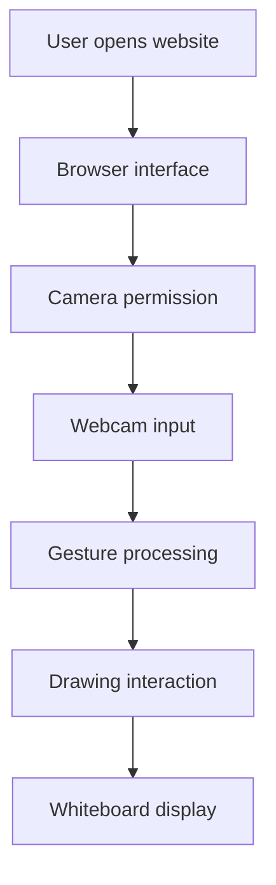

# ✋ Air-WhiteBoard — Gesture-Based Virtual Whiteboard

**Turn your hand movements into digital drawings.**

Air-WhiteBoard is a browser-based virtual whiteboard project designed to make digital drawing more interactive using webcam-based hand gestures. The goal is to provide a touch-free drawing experience through a simple, accessible web interface.

\<p align="center">
&#x20; \<a href="[https://air-whiteboard.vercel.app/](https://air-whiteboard.vercel.app/)">
&#x20;   \<strong>🚀 Live Demo\</strong>
&#x20; \</a>
&#x20; &nbsp; • &nbsp;
&#x20; \<a href="[https://github.com/ArjunSharma-55/Air-WhiteBoard](https://github.com/ArjunSharma-55/Air-WhiteBoard)">
&#x20;   \<strong>📂 Source Code\</strong>
&#x20; \</a>
\</p>

---

## 📸 Preview

> Add a real screenshot of your application here after uploading it to the repository.

\<!-- Replace the path below with your actual screenshot file. -->

\<!-- ![Air-WhiteBoard Preview]\(assets/air-whiteboard-preview\.png) -->

---

## ✨ Project Goals

- 🖐️ **Gesture-Based Interaction** — Explore drawing through hand movements using a webcam.
- 🎨 **Digital Drawing** — Provide an interactive space for creating drawings.
- 🌐 **Browser-Based Experience** — Access the application through a supported web browser.
- 📱 **Responsive Interface** — Aim for usability across desktop, tablet, and mobile screens.
- ⚡ **Real-Time Interaction** — Keep drawing interactions responsive.
- 🧩 **Simple Web Technologies** — Build the project using HTML, CSS, and JavaScript.

*The available controls and gesture capabilities depend on the features implemented in the current source code.*

## 🛠️ Tech Stack

| Technology            | Purpose                                           |
| --------------------- | ------------------------------------------------- |
| HTML5                 | Web page structure                                |
| CSS3                  | Styling, layout, and responsive design            |
| JavaScript            | Application logic and user interactions           |
| Webcam APIs           | Camera access, where implemented                  |
| Hand-tracking library | Gesture recognition, if configured in the project |
| Vercel                | Live website hosting                              |

## 🚀 Getting Started

### Option 1: Use the Live Demo

Open the deployed application:

**[https://air-whiteboard.vercel.app/](https://air-whiteboard.vercel.app/)**

If the application requests camera access, allow permission to use the webcam for its gesture-based functionality.

### Option 2: Run Locally

**1. Clone the repository**

```bash
git clone https://github.com/ArjunSharma-55/Air-WhiteBoard.git
```

**2. Open the project folder**

```bash
cd Air-WhiteBoard
```

**3. Run the application**

Open `index.html` in a browser, or use the **Live Server** extension in Visual Studio Code.

For webcam features, use `localhost` through a local development server or the deployed HTTPS website. Browser camera permissions may not work when opening files directly using a `file://` URL.

## 🖐️ How to Use

1. Open the website in a supported browser.
2. Grant camera permission if prompted.
3. Position your hand within the webcam frame.
4. Follow the application's on-screen instructions for supported gestures.
5. Use the available drawing tools and controls.
6. Test the clear or reset option if it is available.

> Refer to the actual application interface for the supported gestures and controls.

## 🔐 Privacy

- Camera access requires browser permission.
- Only grant camera access to websites you trust.
- Review the source code to understand how camera frames and hand-tracking data are processed.
- Do not assume that camera processing is entirely local until the implementation has been verified.

## 🧱 Project Structure

```text
Air-WhiteBoard/
├── index.html    # Main application page
├── style.css     # Styles and responsive layout
├── script.js     # Application logic
└── README.md     # Project documentation
```

## 🏗️ Architecture



*This is a conceptual architecture. Adjust the diagram to match the actual implementation and libraries used.*

## 🧪 Testing Checklist

- [ ] Website loads without JavaScript errors.
- [ ] Webcam permission can be granted.
- [ ] Camera-denied state is handled clearly.
- [ ] Hand detection works under suitable lighting, if implemented.
- [ ] Drawing responds correctly to supported gestures.
- [ ] Available drawing controls work correctly.
- [ ] Clear or reset functionality works, if implemented.
- [ ] Layout works on desktop and mobile screens.
- [ ] Website works on the deployed HTTPS version.
- [ ] No unnecessary camera stream remains active after stopping the feature.

## 🐛 Troubleshooting

### Camera is not working

- Check browser camera permissions.
- Close other applications that may be using the webcam.
- Use a supported, up-to-date browser.
- Run the website through HTTPS or `localhost`.
- Reload the page after changing permissions.

### Hand gestures are not detected

- Improve lighting in the room.
- Keep your hand inside the camera frame.
- Avoid backgrounds that make your hand difficult to distinguish.
- Check the browser console for errors related to the camera or gesture-detection library.

### Website is slow

- Close unnecessary browser tabs.
- Check whether video processing is consuming too many resources.
- Profile the application before reporting performance figures.
- Test on multiple devices before claiming a specific FPS or latency.

## 🔮 Future Improvements

Potential improvements, depending on project scope:

- [ ] Multiple brush colors and adjustable brush sizes
- [ ] Eraser, undo, and redo
- [ ] Save drawings as PNG images
- [ ] Download or export drawings
- [ ] Improved gesture tracking and stroke smoothing
- [ ] Better mobile and tablet support
- [ ] Accessible controls and keyboard alternatives
- [ ] Automated tests and performance profiling
- [ ] Screenshots and a demonstration GIF in the README

## 🤝 Contributing

Contributions and suggestions are welcome.

1. Fork this repository.
2. Create a feature branch.
3. Implement and test your changes.
4. Commit and push your changes.
5. Open a pull request describing the improvement.

## 👨‍💻 Author

**Arjun Sharma**

- GitHub: [https://github.com/ArjunSharma-55](https://github.com/ArjunSharma-55)
- Project: [https://github.com/ArjunSharma-55/Air-WhiteBoard](https://github.com/ArjunSharma-55/Air-WhiteBoard)
- Live Demo: [https://air-whiteboard.vercel.app/](https://air-whiteboard.vercel.app/)

## 📄 License

No license has been specified here. Before reusing or redistributing this project, add an appropriate `LICENSE` file and update this section to match it.

---

⭐ If you find this project interesting, consider starring the repository and sharing your feedback.

**Built as a hands-on exploration of interactive web development and gesture-based interfaces.**
