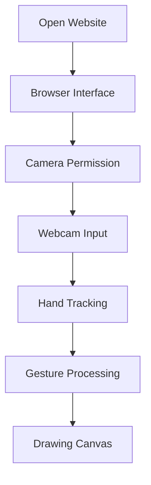

# ✋ Air-WhiteBoard — Gesture-Based Virtual Whiteboard

<div align="center">


### Turn Your Hand Movements into Digital Drawings

A browser-based virtual whiteboard project exploring touch-free drawing through webcam-based hand gestures and an interactive digital canvas.

[](https://arjunsharma-55.github.io/Air-WhiteBoard/)

[](https://github.com/ArjunSharma-55/Air-WhiteBoard)

[](https://developer.mozilla.org/en-US/docs/Web/HTML)
[](https://developer.mozilla.org/en-US/docs/Web/CSS)
[](https://developer.mozilla.org/en-US/docs/Web/JavaScript)

</div>

---

## 📑 Table of Contents

- [About the Project](#-about-the-project)
- [Live Demo](#-live-demo)
- [Project Highlights](#-project-highlights)
- [Technology Stack](#-technology-stack)
- [Getting Started](#-getting-started)
- [How to Use](#-how-to-use)
- [Project Structure](#-project-structure)
- [Architecture](#-architecture)
- [Privacy and Permissions](#-privacy-and-permissions)
- [Testing](#-testing)
- [Future Improvements](#-future-improvements)
- [Contributing](#-contributing)
- [Author](#-author)
- [License](#-license)

## 🎨 About the Project

**Air-WhiteBoard** is a gesture-based virtual whiteboard project designed to make digital drawing more interactive.

The project explores how webcam input and hand-tracking techniques can create a touch-free drawing experience through a browser interface.

### 🎯 Project Goals

- 🖐️ Explore hand-gesture interaction.
- 🎨 Provide a digital drawing canvas.
- 🌐 Make the experience accessible through a web browser.
- ⚡ Practice interactive frontend development.
- 🧩 Explore the possibilities of webcam-based interfaces.

*Available gestures and drawing controls depend on the functionality implemented in the current version.*

## 🌐 Live Demo

Try the deployed project directly in your browser.

<div align="center">

[](https://arjunsharma-55.github.io/Air-WhiteBoard/)

**Live Website:**  
https://arjunsharma-55.github.io/Air-WhiteBoard/

**GitHub Repository:**  
https://github.com/ArjunSharma-55/Air-WhiteBoard

</div>

If the application requests camera permission, allow access only if you want to use its webcam-based features and trust the website.

## ✨ Project Highlights

<table>
<tr>
<td width="50%" valign="top">

### ✋ Gesture Interaction

Explore touch-free drawing using supported hand movements.

</td>
<td width="50%" valign="top">

### 🎨 Digital Canvas

A virtual space for creating drawings through the application interface.

</td>
</tr>
<tr>
<td width="50%" valign="top">

### 📷 Webcam Input

Camera-based interaction where supported by the implementation.

</td>
<td width="50%" valign="top">

### 💻 Browser-Based

A web project built around familiar frontend technologies.

</td>
</tr>
</table>

## 🛠️ Technology Stack

| Technology | Purpose |
|---|---|
| HTML5 | Page structure |
| CSS3 | Styling and layout |
| JavaScript | Application logic and interaction |
| Browser Camera APIs | Webcam access, if implemented |
| Hand-Tracking Library | Gesture recognition, if configured |
| GitHub Pages | Live website hosting |

## 🚀 Getting Started

### Option 1 — Open the Live Demo

Visit:

**[Launch Air-WhiteBoard →](https://arjunsharma-55.github.io/Air-WhiteBoard/)**

Use a supported browser and grant camera permission if required for the gesture-based functionality.

### Option 2 — Run Locally

**1. Clone the repository**

```bash
git clone https://github.com/ArjunSharma-55/Air-WhiteBoard.git
```

**2. Enter the project folder**

```bash
cd Air-WhiteBoard
```

**3. Open the project**

Open `index.html` in your browser, or open the folder in Visual Studio Code and run it using the Live Server extension.

For webcam access, use a secure HTTPS website or `localhost`. Camera permissions may not work when opening a page directly through a `file://` URL.

## 🖐️ How to Use

1. Open the live website.
2. Allow camera permission if the application requests it.
3. Position your hand inside the camera frame.
4. Follow the on-screen instructions for supported gestures.
5. Use the drawing interface and available controls.
6. Try any available clear or reset option.

*Exact controls and gestures depend on the current application version.*

## 📂 Project Structure

```text
Air-WhiteBoard/
├── index.html
├── style.css
├── script.js
└── README.md
```

This is a typical structure for the project. Update the tree if your repository contains additional files or different filenames.

## 🧠 Architecture

The following diagram illustrates a conceptual gesture-drawing workflow.



*The actual flow depends on the camera and hand-tracking libraries used in the implementation.*

## 🔐 Privacy and Permissions

- Camera access requires browser permission.
- Grant camera access only to websites you trust.
- Review the source code to understand how camera frames are processed.
- Do not assume that all camera processing happens locally without verifying the implementation.
- Stop the camera feature when you no longer need it, if the application provides a control.

## 🧪 Testing Checklist

Use this checklist when testing the current version:

- [ ] Website loads without JavaScript errors.
- [ ] Camera permission is requested when needed.
- [ ] Camera-denied scenarios are handled clearly.
- [ ] Hand detection works under suitable lighting, if implemented.
- [ ] Drawing responds to supported gestures.
- [ ] Available drawing controls work correctly.
- [ ] Clear or reset works, if implemented.
- [ ] Layout works on desktop and mobile.
- [ ] Deployed HTTPS version works as expected.
- [ ] Camera resources are released when the feature stops.

## 🔮 Future Improvements

Potential improvements for future releases:

- [ ] Multiple brush colors and adjustable sizes
- [ ] Eraser, undo, and redo
- [ ] Save drawings as PNG images
- [ ] Export and download drawings
- [ ] Improved gesture tracking and stroke smoothing
- [ ] Better tablet and mobile support
- [ ] Keyboard alternatives and accessibility improvements
- [ ] Automated tests and performance profiling
- [ ] Demo GIF and screenshots

## 🤝 Contributing

Contributions and suggestions are welcome.

1. Fork the repository.
2. Create a feature branch.
3. Make and test your changes.
4. Commit and push your changes.
5. Open a pull request explaining the improvement.

## 👨‍💻 Author

<div align="center">

### Arjun Sharma


Interested in web development, interactive applications, and building practical projects.

[](https://github.com/ArjunSharma-55)

[](https://arjunsharma-55.github.io/Air-WhiteBoard/)

</div>

## 📄 License

Check the repository for a `LICENSE` file to determine the applicable usage and distribution terms. If no license is present, do not assume that others have permission to reuse or redistribute the code.

---

<div align="center">

### ✋ DRAW WITHOUT TOUCH.
### 🎨 CREATE WITH MOVEMENT.
### ⚡ EXPLORE NEW POSSIBILITIES.

**Air-WhiteBoard — Gesture-Based Virtual Whiteboard**

[🚀 **OPEN LIVE DEMO**](https://arjunsharma-55.github.io/Air-WhiteBoard/)

[⭐ **VIEW SOURCE CODE**](https://github.com/ArjunSharma-55/Air-WhiteBoard)

<sub>Built by Arjun Sharma.</sub>

</div>
